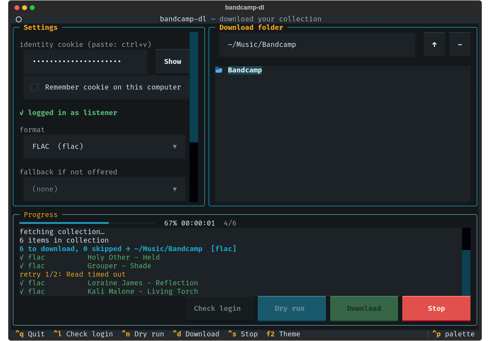

# bandcamp-dl

Downloads every purchase in your Bandcamp collection in the format you pick
(FLAC, WAV, Ogg Vorbis, MP3, ALAC, AAC, AIFF). Albums are unzipped into
`Artist/Album/`. Re-running only fetches what is new.

## Setup

    pip install -r requirements.txt      # requests (+ textual for the TUI)

On Debian/Ubuntu: `apt install python3-requests python3-textual`.

## Log in (borrow your browser session)

Bandcamp's login form has a captcha, so the script uses the cookie of a
browser that is already logged in. Either:

* **identity cookie only** — in the browser on bandcamp.com open
  DevTools → Storage/Application → Cookies → `https://bandcamp.com`, copy the
  value of `identity`, then

      export BANDCAMP_IDENTITY='7%09abc...'

* **cookies.txt** — export with a "cookies.txt" browser extension and pass
  `--cookies cookies.txt`.

Treat the cookie like a password; it is your logged-in session.

## Terminal UI

    ./bandcamp_tui.py

* **Cookie** — paste the `identity` value into the box (ctrl+v, or your
  terminal's paste). Pasting `identity=…`, a quoted value or a whole
  `Cookie:` header also works; it is trimmed to the value. *Show* reveals
  it. Tick *Remember* to keep it in `~/.config/bandcamp-dl/identity`
  (mode 0600); otherwise it is not written anywhere. `BANDCAMP_IDENTITY`
  pre-fills it.
* **Folder** — type a path (created if missing; Enter browses there) or
  pick one in the tree; `↑` goes to the parent, `~` home.
* **Format** — a first choice and an optional fallback, plus parallel
  downloads, hidden items, keep zips and force.
* **Run** — *Check login* (ctrl+l), *Dry run* (ctrl+n), *Download*
  (ctrl+d), *Stop* (ctrl+s; running files finish, the rest are dropped).
  Progress bar with ETA, coloured log (done / retry / failed).
* **Theme** — pick one in the settings or cycle with F2; `bandcamp`
  (default) and `bandcamp-light` plus Textual's built-ins (nord, gruvbox,
  dracula, tokyo-night, catppuccin, solarized, …). Also in the ctrl+p
  palette.

Settings and theme are saved in `~/.config/bandcamp-dl/config.json`.
Same state file as the CLI, so the two can be mixed.

## Command line

    ./bandcamp_dl.py -f flac -o ~/Music/Bandcamp --dry-run   # see the list
    ./bandcamp_dl.py -f flac -o ~/Music/Bandcamp             # download
    ./bandcamp_dl.py -f flac,wav                             # FLAC, else WAV
    ./bandcamp_dl.py -f ogg --include-hidden                 # hidden items too

| `-f` value | Bandcamp format |
|---|---|
| `flac` | FLAC |
| `wav` | WAV |
| `ogg` / `vorbis` | Ogg Vorbis |
| `mp3` / `mp3-320` | MP3 320 |
| `v0` / `mp3-v0` | MP3 V0 |
| `alac` | Apple Lossless |
| `aac` / `m4a` / `aac-hi` | AAC |
| `aiff` / `aiff-lossless` | AIFF |

Other options: `-j N` parallel downloads (default 3), `--keep-zip`,
`--force` (re-download), `--limit N`, `--retries N`.

Progress lives in `<output>/.bandcamp-dl-state.json`; items already done in an
acceptable format are skipped. Delete the file or use `--force` to start over.
Exit status is 1 if any item failed (it keeps going and lists them).

Items without a download link (pre-orders, some subscription items) are
listed and skipped.
